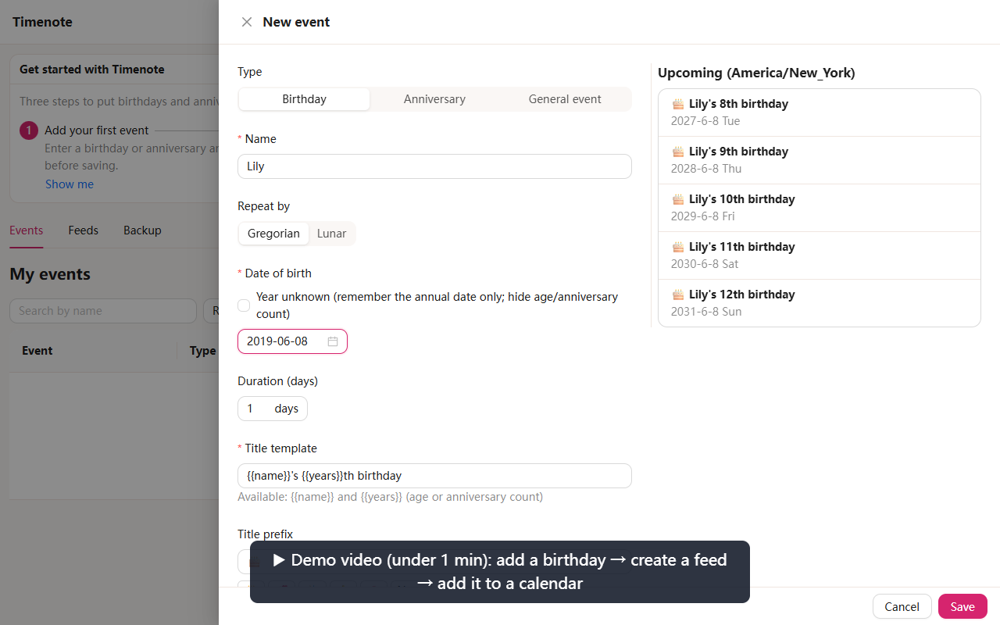
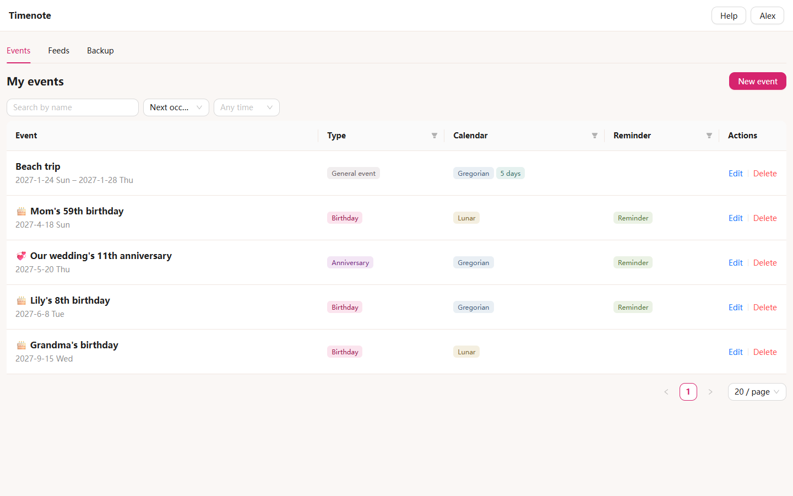
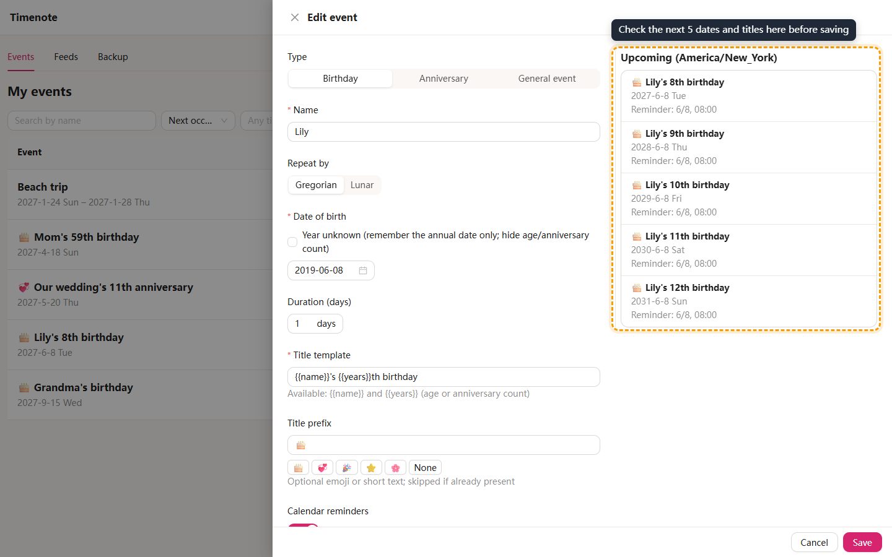
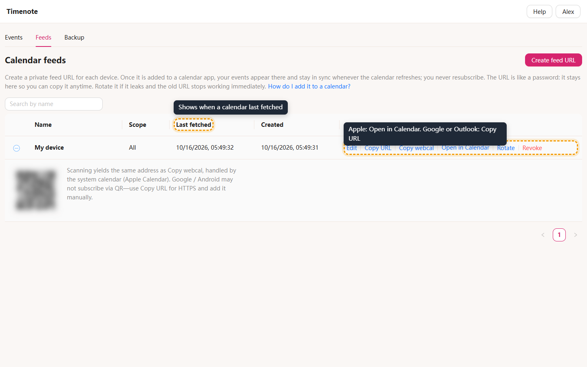
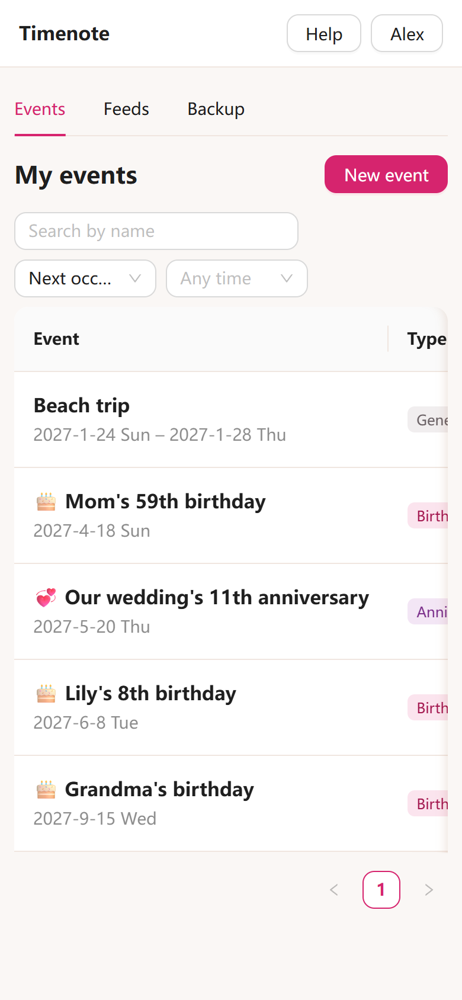
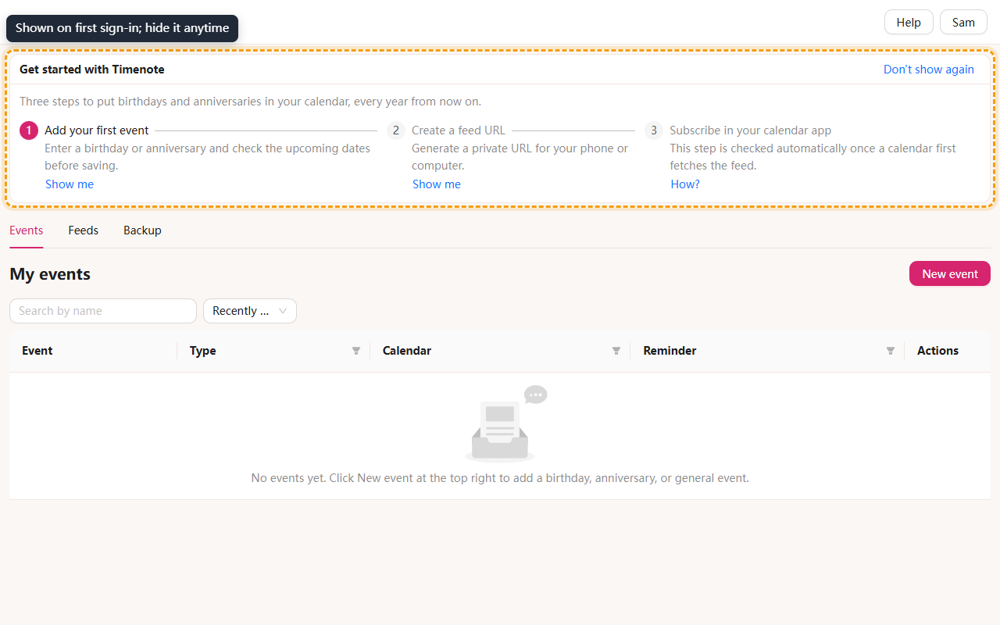
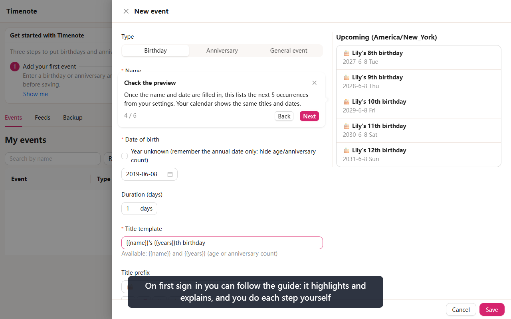
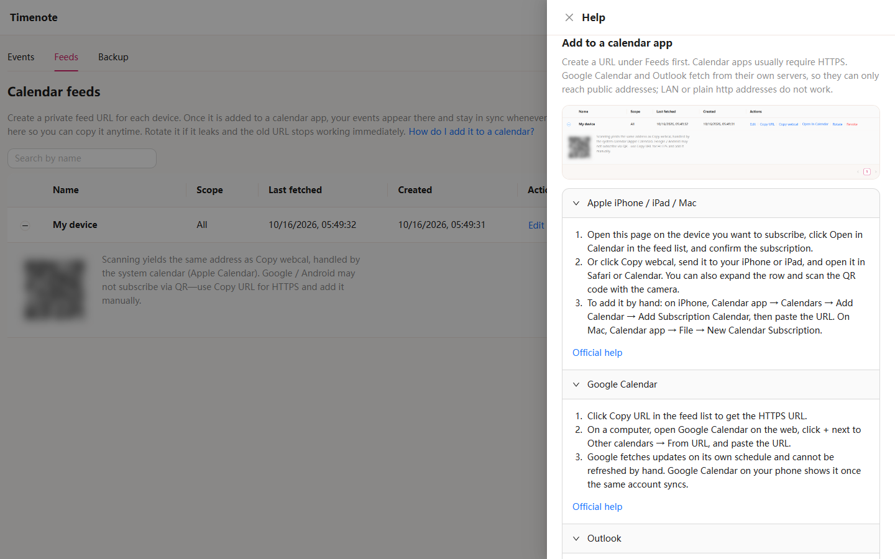

English | [中文](README.zh-CN.md)

# Timenote

Timenote (岁时记) keeps track of your family's birthdays and anniversaries. Enter the original date once. Timenote works out every future occurrence by the Gregorian or Chinese lunar calendar and puts them, with your reminders, into the calendar you already use on your phone or computer through a private feed URL. Your data stays on a server you run yourself.

[](docs/media/en/core-flow.webm)

Click the image to open the demo video (WebM, under 1 minute, silent, with English captions): add a birthday → check the preview → turn on a reminder → create a feed URL → add it to a calendar. GitHub cannot play it inline; clicking opens it in a new tab or downloads it. In the video the recording script fetches the feed in place of a calendar app, and the caption says so.

## What it does

- **Birthdays, anniversaries, and one-off events**: birthdays show the age, anniversaries show the year count, and one-off events happen once and can span several days.
- **Gregorian and lunar dates**: a lunar birthday is converted to that year's Gregorian date. Leap months, the 30th, February 29, and unknown birth years all follow clear rules you can change before saving.
- **Preview before saving**: while you edit, the next 5 dates, titles, and reminder times update on the right. That is exactly what your calendar will show.
- **Works with the calendar you already use**: Apple Calendar, Google Calendar, Outlook, and any client that subscribes to ICS or webcal. New or edited events sync the next time the calendar refreshes; you never resubscribe.
- **One private URL per device**: the URL contains no names or dates. If it leaks, rotate it and the old URL stops working immediately.
- **For the whole family**: an admin creates an account for each person, and each account's events and feeds stay separate.

## A quick look

Events, sorted by next occurrence, with lunar dates and reminders marked.



Editing an event: fill in the form on the left and check the next 5 occurrences on the right.



Feeds: on Apple devices click Open in Calendar or scan the QR code; for Google or Outlook click Copy URL and add it in the calendar. Last fetched shows when a calendar last fetched the feed.





It works in a phone browser too; swipe the table sideways to see more columns.

## Getting started

After you sign in, a three-step Get started checklist appears at the top. A new account with no events also starts the two guides automatically (add your first event, then put it on a calendar), and only once: after you close, pause, or finish them, a refresh or another sign-in will not start them again. Restart either guide from the checklist or from Help in the top right. Each step ticks itself when done, and the checklist goes away once all three are done. Click Don't show again to hide it early.



1. **Add your first event**: click New event, pick a type, enter a name and date, check the preview on the right, and save.
2. **Create a feed URL**: on the Feeds page, click Create feed URL and name it after the device.
3. **Subscribe in your calendar app**:
   - Apple iPhone / iPad / Mac: open this site on the device you want to subscribe, click Open in Calendar, and confirm. You can also expand the row and scan the QR code with the camera.
   - Google Calendar: click Copy URL, open Google Calendar on the web on a computer, click + next to Other calendars → From URL, and paste.
   - Outlook: click Copy URL, then in Outlook on the web choose Add calendar → Subscribe from web, and paste.

   Step 3 ticks itself the first time a calendar fetches the feed. Google Calendar and Outlook fetch from their own servers, so they need a public HTTPS address, and the first sync can take from a few hours to more than a day.

Each step has a Show me button that highlights where to click. The guide only highlights and explains; you do the typing, saving, copying, and opening yourself. Closing the form midway pauses the guide, and you can resume later. [Watch the guide demo](docs/media/en/guide-tour.webm) (WebM, about 25 seconds).



## When something goes wrong

Help in the top right has step-by-step instructions for each calendar app with links to their official help, plus an FAQ:

- **How long until events show up?** The calendar app decides how often it refreshes. Apple Calendar can be pulled down to refresh; Google Calendar and Outlook fetch on their own schedule. Last fetched on the Feeds page shows when a calendar last fetched.
- **No reminder on my phone?** First check that Calendar reminders is on for the event. iPhone may strip alerts from subscribed calendars by default: Settings → Calendar → Accounts → Subscribed Calendars, pick this calendar, and turn off Remove Alerts.
- **My feed URL leaked.** On the Feeds page click Rotate. The old URL stops working immediately; subscribe again with the new one.
- **How do I back up?** The Backup page exports JSON with the current account's events. Import first shows how many events will be added or overwritten and writes only after you confirm.



Precise rules for lunar dates, leap months, the 30th, and February 29 are in [anniversary rules](docs/anniversary-rules.md) (Chinese).

## Self-hosting

### Try it locally

Install Node.js 22.21.1 (or a newer Node 22 / Node 24), then run:

```sh
npm install --global pnpm@10.28.0
cd <path-to-this-repo>
pnpm install --frozen-lockfile
pnpm env:init
pnpm dev
```

`env:init` writes a basic `.env` only when that file does not exist; it does not overwrite an existing file. `.env` is gitignored. Open [Timenote](http://127.0.0.1:8720). On an empty database, create the admin account on the first-run setup page.

| Service                       | Address                      |
| ----------------------------- | ---------------------------- |
| Web and same-origin API proxy | http://127.0.0.1:8720        |
| API health check              | http://127.0.0.1:8721/health |

One process starts two listeners: the web server (Vite middleware in development, static files in production) and a Fastify API bound only to `127.0.0.1`. Browsers and calendar apps talk only to the web server. `/api/*` is proxied on the same origin. In development the web server binds `0.0.0.0` by default and prints LAN addresses in the startup log. To debug feeds from a phone, set `WEB_ORIGIN` to that LAN address and restart.

Check the production static build:

```sh
pnpm build
pnpm start
```

### Accounts and registration

- On an empty database, create the first admin on the web setup page (`POST /api/setup/admin`). There is no `INITIAL_ADMIN` environment variable.
- Public self-registration is off by default (`PUBLIC_REGISTER_ENABLED`). When it is on, `REGISTER_DEFAULT_DISABLED` decides whether new accounts start disabled (the default; an admin must enable them).
- Admins create, enable, disable, reset passwords for, and delete accounts under Accounts, and can set each account's time zone; reminders use the account time zone. Admins cannot read other accounts' events.
- For a database-level backup, run `pnpm db:backup`.

All settings are in [environment variables](docs/environment-variables.md) (Chinese).

### Deploy to a server

A single Docker instance with a named volume for persistence. GitHub Actions publishes it: after a pull request is merged into `main`, the workflow builds an image, pushes it to `ghcr.io/fuego-zero/timenote`, then SSHs to the server to pull and start it. The server does not clone the repository. HTTPS and certificates are the deployer's responsibility (see [deploy/nginx.example.conf](deploy/nginx.example.conf)); calendar subscriptions need a public HTTPS address. Secrets, the first cutover, and rollback are in the [deployment notes](docs/deployment.md) (Chinese). Security constraints are in the [security notes](docs/security.md) (Chinese). Real-device checks for each calendar app are in the [subscription acceptance checklist](docs/subscription-acceptance.md) (Chinese).

## Contributing

Structure, data flow, and the UID strategy are in the [architecture notes](docs/architecture.md) (Chinese). Quality checks, end-to-end tests, and AI tooling are in the [development notes](docs/development.md) (Chinese). How to regenerate the screenshots and demo videos on this page is in [guide and demo media](docs/guide-media.md) (Chinese).

Product behavior is informed by TimeMark (read-only; see `.cursor/rules/02-timemark-readonly.mdc`). Stack: a pnpm workspace, TypeScript strict, Fastify + SQLite, React + Ant Design, Vitest + Playwright.
