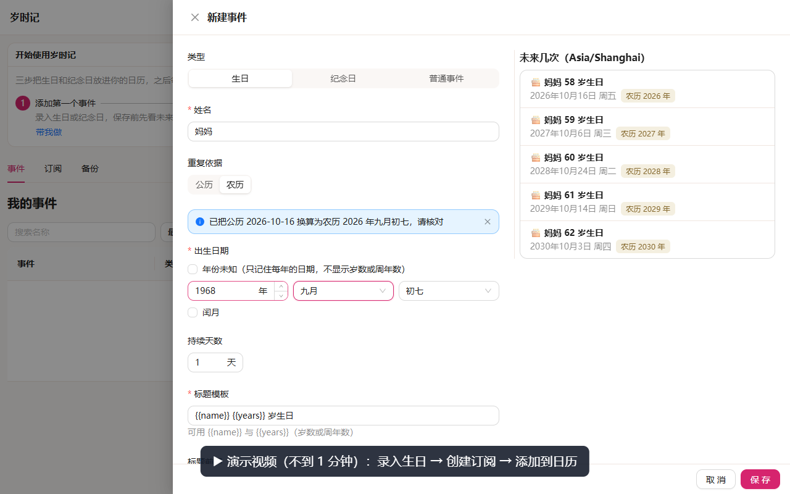
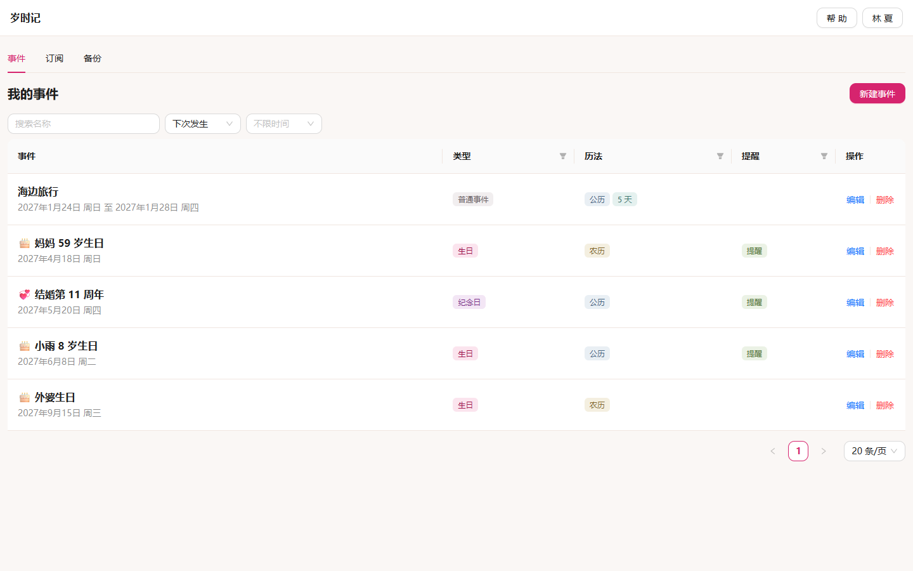
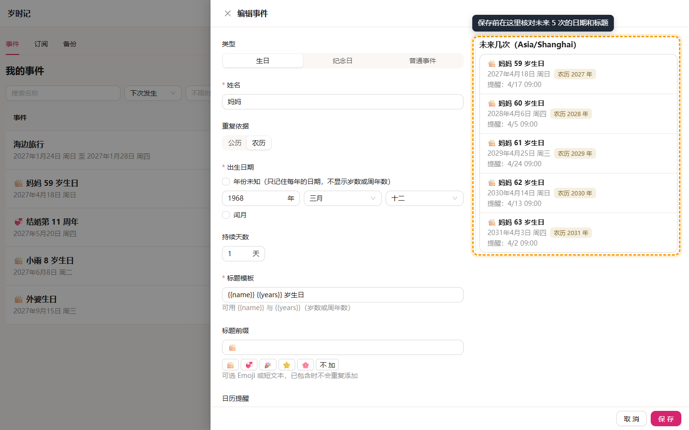
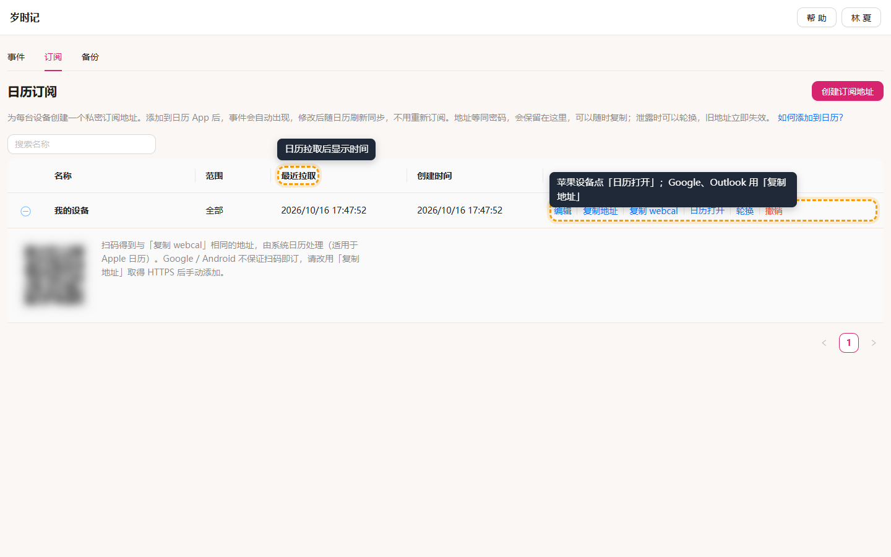
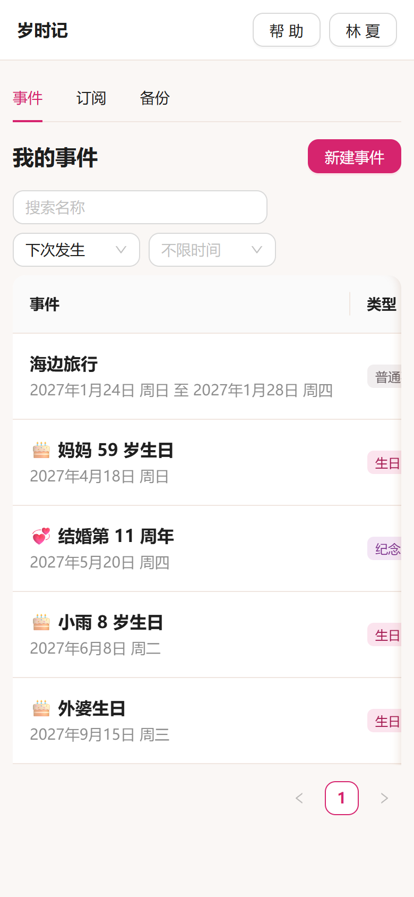
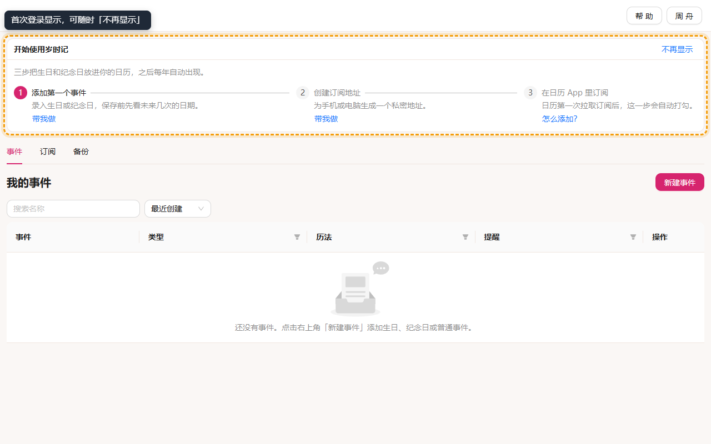
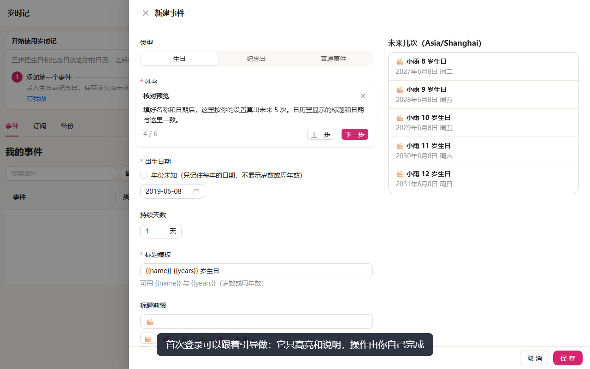
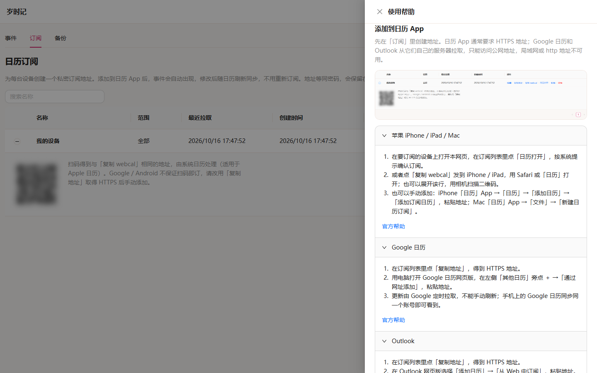

[English](README.md) | 中文

# 岁时记

岁时记（Timenote）帮你记住家人的生日和纪念日。录入一次原始日期，它会按公历或农历算出以后每一年的日子，通过私密订阅地址出现在手机或电脑自带的日历里，并带上你设定的提醒。数据保存在你自己部署的服务器上。

[](docs/media/zh-CN/core-flow.webm)

点击上图打开演示视频（WebM，不到 1 分钟，无声，画面带中文字幕）：录入生日 → 预览 → 打开提醒 → 创建订阅地址 → 添加到日历。GitHub 页面里不能直接播放，点击后会在新标签页打开或下载。视频中「日历拉取订阅」这一步由录制脚本代替日历 App 完成，字幕里有标注。

## 它能做什么

- **生日、纪念日、普通事件**：生日显示「N 岁」，纪念日显示「第 N 周年」，普通事件只发生一次，也可以跨好几天。
- **公历和农历**：农历生日每年换算成当年的公历日期；闰月、三十、2 月 29 日、年份未知都有明确规则，保存前可以改。
- **保存前先预览**：编辑时右侧实时列出未来 5 次的日期、标题和提醒时间，日历里看到的就是这些。
- **放进你已经在用的日历**：苹果日历、Google 日历、Outlook 等支持 ICS / webcal 订阅的客户端都能用。之后新增或修改事件，日历刷新后自动同步，不用重新订阅。
- **每台设备一个私密地址**：地址里不含姓名和日期；泄露时一键轮换，旧地址立即失效。
- **全家共用**：管理员为每位家人创建账号，各自的事件和订阅互相隔离。

## 看看界面

事件列表：按下次发生排序，农历、提醒一目了然。



编辑事件：左侧填写，右侧预览未来 5 次。



订阅页：苹果设备点「日历打开」或扫码，Google、Outlook 点「复制地址」后到日历里添加；「最近拉取」显示日历最后一次来取的时间。





手机浏览器同样可用；表格可以左右滑动查看更多列。

## 第一次使用

登录后，页面上方会出现「开始使用」三步清单。还没有事件的新用户会自动开始两段引导（添加第一个事件、放进日历），只自动一次：关掉、暂停或完成后，刷新和再次登录都不会再自动开始，需要时从清单或右上角「帮助」重新开始。完成一步打勾一步，全部完成后清单不再出现；不需要时点「不再显示」。



1. **添加第一个事件**：点「新建事件」，选择类型、填写名称和日期，确认右侧预览后保存。
2. **创建订阅地址**：在「订阅」页点「创建订阅地址」，为这台设备起个名字。
3. **在日历 App 里订阅**：
   - 苹果 iPhone / iPad / Mac：在要订阅的设备上打开网页，点「日历打开」，按系统提示确认；也可以展开那一行，用相机扫码。
   - Google 日历：点「复制地址」，在电脑上打开 Google 日历网页版，「其他日历」旁的 ＋ →「通过网址添加」，粘贴。
   - Outlook：点「复制地址」，在 Outlook 网页版「添加日历」→「从 Web 中订阅」，粘贴。

   日历第一次来拉取后，第 3 步会自动打勾。Google 日历和 Outlook 从它们自己的服务器拉取，只能访问公网 HTTPS 地址，首次同步可能要几个小时到一天以上。

每一步都可以点「带我做」，让引导高亮要点的位置。引导只高亮和说明，填写、保存、复制地址和打开日历都由你自己完成；中途关掉表单会暂停，之后可以继续。[观看引导演示](docs/media/zh-CN/guide-tour.webm)（WebM，约 25 秒）。



## 遇到问题

右上角「帮助」里有各日历客户端的详细步骤和官方帮助链接，以及常见问题：

- **多久出现在日历里？** 刷新频率由日历 App 决定。苹果日历可以下拉刷新；Google 日历和 Outlook 由它们的服务器定时拉取。订阅页的「最近拉取」显示日历最后一次来取的时间。
- **手机上没弹提醒？** 先确认事件里打开了「日历提醒」。iPhone 可能默认移除订阅日历的提醒：「设置」→「日历」→「账户」→「已订阅的日历」，选中这个日历，关闭「移除提醒」。
- **订阅地址泄露了？** 在「订阅」里点「轮换」，旧地址立即失效，用新地址重新订阅。
- **怎么备份？** 「备份」页可以导出 JSON，只含当前账号的事件；导入前先显示将新增和覆盖的数量，确认后才写入。



农历、闰月、三十、2 月 29 日的精确规则见[纪念日规则](docs/anniversary-rules.md)。

## 自己部署

### 本机试用

安装 Node.js 22.21.1（或更新的 Node 22 / Node 24），然后运行：

```sh
npm install --global pnpm@10.28.0
cd <当前仓库路径>
pnpm install --frozen-lockfile
pnpm env:init
pnpm dev
```

`env:init` 只在 `.env` 不存在时生成基础配置，不覆盖已有文件；`.env` 已被 Git 忽略。打开 [岁时记](http://127.0.0.1:8720)，空库时按首次设置页创建管理员账号。

| 服务                | 地址                         |
| ------------------- | ---------------------------- |
| Web 与同源 API 反代 | http://127.0.0.1:8720        |
| API 健康检查        | http://127.0.0.1:8721/health |

一个进程内启动两个监听器：Web（开发时挂 Vite 中间件，生产时提供静态文件）和只绑 `127.0.0.1` 的 Fastify API；浏览器与日历 App 都只访问 Web，`/api/*` 由 Web 同源反代。开发环境 Web 默认绑 `0.0.0.0` 并在启动日志打印局域网地址，手机调试订阅时把 `WEB_ORIGIN` 改成该局域网地址后重启。

检查生产静态构建：

```sh
pnpm build
pnpm start
```

### 账号与注册

- 空库时在 Web 首次设置页创建首个管理员（`POST /api/setup/admin`），不经 `INITIAL_ADMIN` 等环境变量。
- 公开自助注册默认关闭（`PUBLIC_REGISTER_ENABLED`）；开启后新号是否停用由 `REGISTER_DEFAULT_DISABLED` 决定（默认停用，须管理员启用）。
- 管理员在「账号管理」中创建、启停、重置密码和删除账号，可为账号设置时区，提醒按账号时区换算。管理员不能读取其他账号的事件。
- 数据库级备份用 `pnpm db:backup`。

全部配置项见[环境变量](docs/environment-variables.md)。

### 部署到服务器

单实例 Docker + 命名卷持久化。发布由 GitHub Actions 完成：Pull Request 合并进 `main` 后编译镜像并推到 `ghcr.io/fuego-zero/timenote`，再 SSH 到服务器拉取启动。服务器上不克隆仓库。HTTPS / 证书由部署方自理（示例见 [deploy/nginx.example.conf](deploy/nginx.example.conf)）；日历订阅需要公网 HTTPS 地址。密钥、首次切换和回滚见[部署说明](docs/deployment.md)，安全约束见[安全说明](docs/security.md)，各日历客户端的真机验收见[订阅验收清单](docs/subscription-acceptance.md)。

## 参与开发

工程结构、数据流和 UID 策略见[架构说明](docs/architecture.md)；质量检查、端到端测试和 AI 工程配置见[开发说明](docs/development.md)；本页截图和演示视频的重新生成方式见[引导与演示素材](docs/guide-media.md)。

功能参考自 TimeMark（只读，见 `.cursor/rules/02-timemark-readonly.mdc`）。技术栈：pnpm 工作区、TypeScript strict、Fastify + SQLite、React + Ant Design、Vitest + Playwright。
